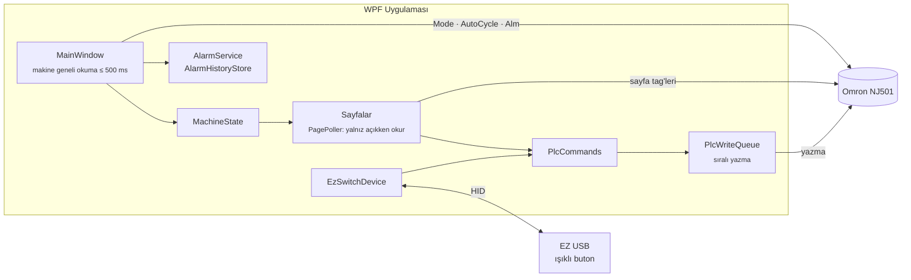

<div align="center">


# İzostatik Tabak Kenar Silme — Operatör Paneli

**Omron NJ501 kontrollü izostatik tabak kenar silme makinesi için WPF operatör arayüzü (HMI)**


</div>

---

## Genel bakış

Bu uygulama, makinenin başındaki 1280×800 dokunmatik ekranda çalışan operatör panelidir. PLC ile EtherNet/IP üzerinden haberleşir; çalışma modunu, makine durumunu ve arızaları anlık gösterir; operatör komutlarını (Start/Stop, Reset, mod seçimi, boşaltma) PLC'ye iletir. Makinedeki USB ışıklı buton modülü de uygulamaya bağlıdır.

Uygulama bir HMI olarak **hiç kapanmamak** üzere tasarlanmıştır: beklenmeyen hatalar yakalanır, loglanır ve ekranda gösterilir.

## Özellikler

| | Özellik | Açıklama |
|---|---|---|
| ⚙️ | **Çalışma modları** | Kapalı · Güvenli · Manuel · Otomatik — üst panelde renkli mod butonları |
| 🟢 | **Makine durumu** | Hazır / Çalışıyor / Arıza Var; kart çerçevesi moda göre renk alır |
| ▶️ | **Otomatik çevrim** | Basılı tutmalı Start/Stop, vardiya ve toplam üretim adetleri, boşaltma kontrolleri |
| 🚨 | **Alarmlar** | 500+ alarm biti izlenir; aktif alarm penceresi, alt çubukta dönen arıza metni, basılı tutmalı Reset |
| 📜 | **Arıza geçmişi** | Alarmın gelişi ve gidişi tarih-saatle kaydedilir; aylık JSON Lines dosyaları, 12 ay saklama |
| 💡 | **Işıklı buton modülü** | Pro-face EZ USB modülü: 1–4 mod seçimi, 5. buton Start/Stop/Reset; durumlara göre renk ve yanıp sönme |
| 🎛️ | **Ayarlar** | 12 istasyon için alt menü; Otomatik sayfasından da kısayolla erişilir |
| 🔍 | **Canlı izleme** | Servis için tag okuma ekranı |
| 🌗 | **Tema** | Koyu ve açık tema, anında geçiş |
| 📝 | **Loglama** | Günlük dosyalar, 30 gün saklama; global hata yakalama |

## Mimari



**Temel ilkeler**

- **Okuma katmanlı:** Ana pencere yalnızca tüm makine için gereken tag'leri (Mode, AutoCycle, alarm dizisi) okur. Her sayfa kendi verisini yalnızca ekranda açıkken okur.
- **Yazma sadece operatör eylemiyle:** Uygulama kendiliğinden PLC'ye bir şey yazmaz. Tüm komutlar `PlcCommands` → `PlcWriteQueue` yoluyla sırayla gider; basılı tutmalı butonlarda TRUE/FALSE sırası karışmaz, FALSE yazımı başarısız olursa tekrar denenir.
- **Arayüz donmaz:** PLC erişimi arka planda yapılır, sonuçlar UI iş parçacığına aktarılır.
- **Alarm dizisi parçalı okunur:** `Alm` dizisi tek seferde okunamadığından 100'lük parçalar halinde (`Alm[başlangıç]`) okunur.

## Proje yapısı

```text
IzostatikTabakKenarSilme/
├── MainWindow.xaml(.cs)        Ana pencere: üst panel, menü, alt durum çubuğu, ana okuma döngüsü
├── App.xaml(.cs)               Ortak stiller, global hata yakalama
├── Pages/
│   ├── OtomatikPage            Çevrim, adetler, boşaltma, ayar kısayolları
│   ├── SectionPage             Sağda alt menülü bölüm sayfası (Ayarlar, Üretim, Genel)
│   ├── AlarmGecmisiPage        Arıza geçmişi
│   ├── CanliIzlemePage         Servis: canlı tag izleme
│   └── PlaceholderPage         Henüz doldurulmamış sayfalar
├── Windows/
│   └── AktifAlarmlarWindow     Aktif alarmlar ve Reset
├── Services/
│   ├── PlcService              libplctag ile okuma/yazma
│   ├── PlcTags                 Tüm tag adları ve mod değerleri (tek yer)
│   ├── PlcCommands             Operatör komutları
│   ├── PlcWriteQueue           Sıralı yazma kuyruğu
│   ├── MachineState            Sayfalara dağıtılan makine durumu
│   ├── PagePoller              Sayfa bazlı okuma döngüsü
│   ├── AlarmService            Alarm kenar algılama
│   ├── AlarmHistoryStore       Arıza geçmişi (JSON Lines)
│   ├── AlarmTextProvider       Alarm metinleri (AlarmMetinleri.csv)
│   ├── EzSwitchDevice          Pro-face EZ USB ışıklı buton modülü
│   └── AppLogger               Dosya loglama
├── Controls/                   HoldButton (basılı tutma), LogoView
├── Themes/                     DarkTheme, LightTheme
└── AlarmMetinleri.csv          Alarm numarası → açıklama
```

## Derleme ve çalıştırma

**Gereksinimler**

- Windows 10/11
- Visual Studio 2022 (".NET masaüstü geliştirme" iş yükü)
- .NET Framework 4.8

**Adımlar**

1. Depoyu klonlayın ve `IzostatikTabakKenarSilme.slnx` dosyasını açın.
2. NuGet paketleri ilk derlemede geri yüklenir (`packages.config`).
3. **Rebuild** ile derleyip çalıştırın.

> **İpucu:** `git pull` öncesinde Visual Studio'yu kapatın; açıkken proje dosyası (`.csproj`) üzerine yazılabiliyor.

**Bağımlılıklar**

| Paket | Sürüm | Kullanım |
|---|---|---|
| libplctag | 1.5.2 | Omron NJ ile EtherNet/IP haberleşmesi |
| HidSharp | 2.1.0 | EZ USB ışıklı buton modülü (HID) |

## Kurulum notları (makine PC'si)

- Pencere çerçevesiz, sabit **1280×800** boyutunda ve ortalanmış açılır.
- Windows ekran ölçeklendirmesi **%100** olmalıdır.
- Uygulamayı kapatmak için alt çubuğun sağındaki **PLC durumu** yazısına dokunun.
- PLC bağlantı ayarları `Services/PlcService.cs` içindedir.

## Veri ve log konumları

| Ne | Nerede | Saklama |
|---|---|---|
| Arıza geçmişi | `<uygulama klasörü>\AlarmGecmisi\yyyy-MM.jsonl` | 12 ay |
| Uygulama logları | `%LOCALAPPDATA%\IzostatikTabakKenarSilme\Logs` | 30 gün |

## Güvenlik

Bu yazılım gerçek bir makineyi kontrol eder.

- PLC'ye yazan her değişiklik, devreye alınmadan önce **makinenin başında** denenmelidir.
- Tag adları ve veri türleri Sysmac Studio projesiyle birebir eşleşmelidir; `PlcTags.cs` dışında tag adı yazılmaz.
- Depoya parola, erişim anahtarı veya makineye erişim sağlayan gizli bilgi eklenmez.

## Lisans

Bu proje [GNU GPL v3](LICENSE.txt) lisansı altındadır.
